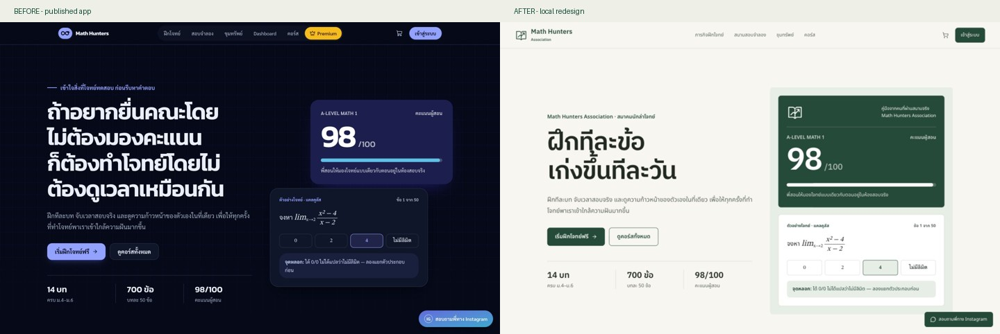

# Math Hunters redesign review

> This is the earlier field-guide review. The current approved island-adventure revision, screenshots, recording, attribution, and verification limits are in [the adventure review](adventure/README.md).

Implemented 28 October 2026. Local implementation; no deployment, live purchase, notification, or production-data mutation.

## Design delivered

A light modern association field guide: ivory, forest green, charcoal, and brass; IBM Plex Sans Thai headings and Noto Sans Thai body text; an original open-guide/ascending-path emblem. Student identity, training choice, and review carry the theme. Actual solving stays quiet.

Public, student, admin, and active-session navigation are classified centrally. The dashboard now prioritises the next existing training recommendation and shows a hunter license using existing identity and progress. Public homepage leads to free practice. Premium practice is a compact secondary offer on the mission board. Small-screen student administration uses readable records; desktop keeps the table.

No XP, levels, earned badges, made-up license IDs, rankings, or new backend schema. Existing question content, course pricing/access, scoring, progress calculations, timers, and payment routes remain in place. The auth callback's default destination is now the headquarters; explicit return paths and onboarding continue to work.

## Screenshots

Before screenshots are from the repository's published deployment. After screenshots are local; authenticated examples use synthetic records, not real students.



| Screen | Desktop | Mobile |
|---|---|---|
| Homepage before | [Before](screenshots/home-before-desktop.jpg) | [Before](screenshots/home-before-mobile.jpg) |
| Homepage after | [After](screenshots/home-after-desktop.jpg) | [After](screenshots/home-after-mobile.jpg) |
| Headquarters | [Desktop](screenshots/headquarters-desktop.jpg) | [Mobile](screenshots/headquarters-mobile.jpg) |
| Admin student list | [Desktop](screenshots/admin-desktop.jpg) | [Mobile](screenshots/admin-mobile.jpg) |
| Missions | — | [Mobile](screenshots/missions-mobile.jpg) |
| Solving | — | [Mobile](screenshots/solving-mobile.jpg) |
| Upload confirmation | — | [Local dummy upload](screenshots/checkout-success-mobile.jpg) |

## Route checklist

Browser review used 1440px, 768px, 390px, and 320px widths. Page-level horizontal overflow was checked; equation containers and controls that intentionally scroll remain usable.

| Route family | Review |
|---|---|
| `/` | Anonymous/signed-in public frame, free-practice CTA, desktop/mobile layouts |
| `/login`, `/onboarding`, `/profile` | Login presentation, required onboarding fields, profile layout |
| `/dashboard` | Populated and empty progress, next training action, license, responsive navigation |
| `/practice`, `/practice/[topicId]` | Mission search/grade filters, question answering, solution, scratchpad drawer, progress-save request |
| `/exam`, `/exam/[examId]`, `/exam/[examId]/result` | Selection, active timer, answer controls, accessible confirmation, local submission/results |
| `/treasure`, `/treasure/[slug]` | Public access, search, calculus/trigonometry content, formula reveal/repeat controls |
| `/pricing`, `/courses`, `/course/[topicId]` | Catalogue, owned-course state, curriculum, Classroom links retained |
| `/cart`, `/checkout`, `/pricing/success` | Empty and populated cart, add/remove and totals, bank/QR tabs, no-file validation, local dummy upload success and failure, existing success page |
| `/premium`, `/premium/practice` | Locked/entitled presentation and empty-bank state; no new premium content |
| `/admin/students`, `/admin/students/[userId]` | Synthetic student records, purchases, performance, desktop table/mobile records |
| `/admin/bank-transfers`, `/admin/premium` | Pending/empty states, local rejection action, import/invite controls and layouts |
| `/privacy` | Presentation updated; legal wording preserved |

## Checks and known limits

- Navigation classification/default destination regression checks pass: `node tests/navigation.test.mjs` (Node 22.13+).
- Production webpack compilation passes. Full build and TypeScript checks stop at the existing `lib/stripe.ts` API-version type mismatch: source requests `2026-08-26.dahlia`, while the installed SDK types accept `2026-04-22.dahlia`. Payment configuration was not changed to conceal this error.
- Repository lint retains the baseline **7 errors and 9 warnings**: exam ref/effect rules, webhook `any` types, and the archived design-handoff bundle. No additional lint findings remain.
- Responsive screenshots were visually reviewed; narrow admin records and the exam timer overlap were corrected during review. The chosen light theme and loaded fonts were confirmed in-browser.
- Basic keyboard access, visible focus, menu operation, touch targets, and Radix exam-dialog focus were checked. Reduced-motion fallbacks are implemented. This is not a full assistive-technology audit or real stylus calibration test.
- Supabase/auth/payment/admin behaviour was exercised with a local in-memory stand-in. Real Google OAuth, Stripe transactions/webhooks, external Classroom links, notifications, real uploads, and real student records were not exercised.
- The premium fixture has an active subscription and an empty question bank; a populated premium paper was not available for verification. Shared practice-session behaviour was checked using the normal question bank.
- QR image routing is preserved; no money was transferred. Existing business logic and known baseline technical issues are outside this visual redesign.

## Run the isolated preview

In the project directory, start the local stand-in:

```sh
node tests/review-server.mjs
```

In a second terminal:

```sh
NEXT_PUBLIC_SUPABASE_URL=http://127.0.0.1:54329 \
NEXT_PUBLIC_SUPABASE_ANON_KEY=local-review-placeholder \
SUPABASE_SERVICE_ROLE_KEY=local-review-service \
ADMIN_EMAILS=review-admin@example.test \
RESEND_API_KEY= ADMIN_NOTIFICATION_WEBHOOK_URL= \
npm run dev -- --port 3001
```

Open `http://localhost:3001` for the public site. The test-only server at `http://localhost:54329/review/student` sets a synthetic local session and redirects to headquarters. Other fixture states: `empty`, `onboarding`, `premium`, `admin`, `anonymous`. Append `?fail=1` to simulate failed writes. This stand-in lives outside the application routes, binds only to loopback, and discards all writes on exit. It is never a production authentication mechanism.

The dev script uses webpack, matching the existing production build, because this environment's Turbopack preview failed on the Google-font import map. No new runtime dependency was added.
