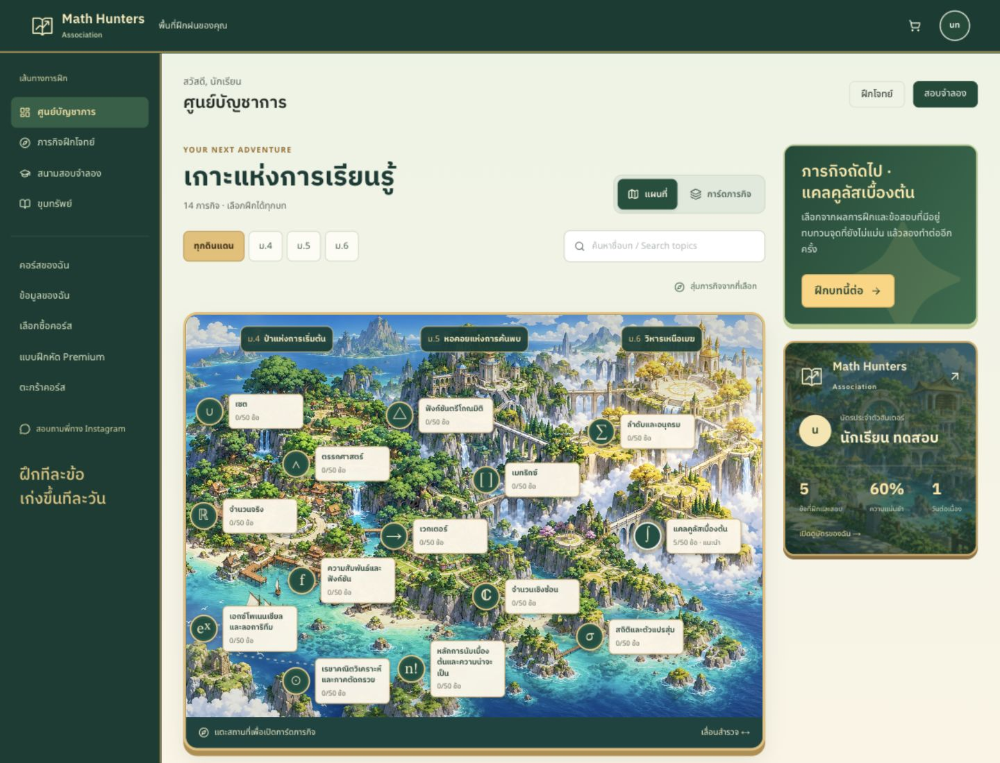
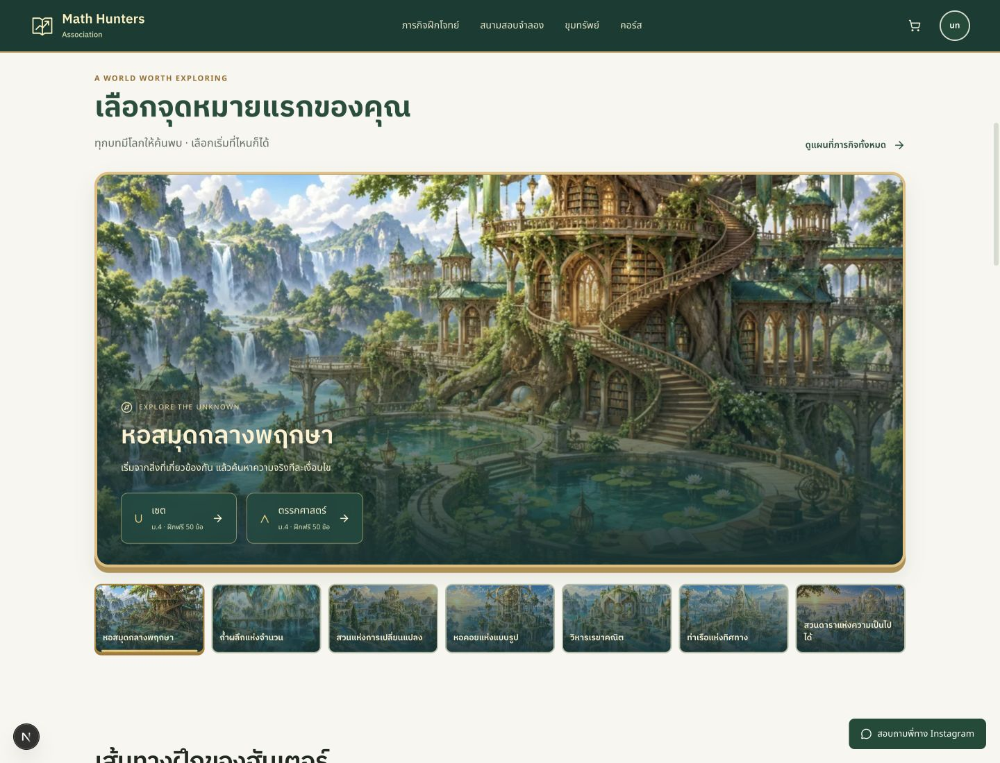

# Math Hunters — Animated Island Adventure

Local review, 29 October 2026. This supersedes the earlier [field-guide presentation](../README.md). No deployment or live financial/admin mutations. Authenticated examples use disposable local fixtures.

## Delivered

The owner subsequently selected **Infinity Atlas (C)** as the new logo. It is now applied across the shared app frame, sign-in page, hunter license, and browser/home-screen icons. [Selected logo and vector exports](../logos/README.md).

- An original island-first headquarters with three labelled grade regions and the existing 14 topics, distributed 6/5/3. The current training recommendation sits alongside the map. Paths do not lock access.
- Explicit map and illustrated collection views sharing one topic catalogue, search, grade filters, completion, and selected briefing. Desktop side panel, mobile bottom sheet, keyboard activation, Escape, and focus restoration.
- An interactive hunter license showing actual name/avatar, answered count, accuracy, and streak. No invented license IDs, XP, levels, badges, rewards, ranks, or leaderboard previews.
- Eleven original illustrations: the island, three grade regions, and seven additional destinations. The homepage adds an interactive destination atlas with ordinary practice links for all 14 topics. Course covers and student entry banners reuse the coordinated artwork.
- Seven React Bits-inspired treatments, adapted to Motion/CSS: perspective cards, pixel reveals, pointer spotlights, golden text sheen, actual-total counters, short content entrances, and selection sparks. Native controls remain immediate.
- Practice feedback distinguishes saving, confirmed save, and failed save. Only a successful correct-answer save produces a success burst. Results reveal the actual submitted exam result. Questions and formulas remain stationary.
- Matching checkout/admin colours with restrained state transitions. Existing authentication, access, question content, scoring, prices, timers, payment APIs, and admin operations remain intact. The catalogue's introductory price is now literal rather than counting up through misleading temporary values.

## Review images and recording

[Short card-reveal recording (GIF)](mission-reveal.gif) · [Homepage before/after](home-comparison.jpg) · [Headquarters before/after](headquarters-comparison.jpg)

Before images show the previous local field-guide pass. After images use the new local design with synthetic student data. Screenshots are viewport captures unless noted.

| Surface | Desktop | Mobile |
|---|---|---|
| Homepage | [Hero](screenshots/home-1440.jpg) | [390px](screenshots/home-390.jpg) |
| Destination atlas | [Atlas](screenshots/atlas-desktop.jpg) | [390px](screenshots/atlas-mobile.jpg) |
| Headquarters | [1440px](screenshots/headquarters-1440.jpg) | [390px](screenshots/headquarters-390.jpg) |
| Mission collection | [1440px](screenshots/collection-1440.jpg) | [390px](screenshots/collection-390.jpg) |
| Briefing | [Completed topic](screenshots/completed-briefing.jpg) | [Bottom sheet](screenshots/briefing-mobile.jpg) |
| License details | [Actual training values](screenshots/license-desktop.jpg) | — |
| Courses | [Library](screenshots/courses-1440.jpg) | [Catalogue](screenshots/pricing-390.jpg) |
| Exam | [Result](screenshots/results-1440.jpg) | [Active exam](screenshots/exam-active-mobile.jpg) |
| Save feedback | [Confirmed](screenshots/practice-saved.jpg) | [Failed write](screenshots/practice-save-error.jpg) |
| Payment upload | — | [Dummy upload confirmation](screenshots/checkout-upload-confirmed.jpg) |
| Admin | [Students](screenshots/admin-students-1440.jpg) | [Disposable action result](screenshots/admin-fixture-action.jpg) |

## Route and interaction checklist

Reviewed 320px, 390px, 768px, and 1440px layouts. The map intentionally scrolls horizontally on narrow screens; the page itself does not. The atlas thumbnail strip also uses native horizontal scrolling. Long Thai labels and formulas retain their original text. Two map label overlaps were found and corrected.

| Route family | Coverage |
|---|---|
| `/` | Hero, three grade cards, seven destination choices, all topic links, retained free CTA, teacher/course content, public navigation |
| `/dashboard` | Populated, empty, and completed-topic fixtures; real recommendation/license values; all 14 landmarks and cards |
| `/practice` | Both views, Thai/English search, grade filters, empty search, random selection, anonymous login return URL |
| `/practice/[topicId]` | Correct answer, saving/confirmed/failed-write feedback, original solution and scratchpad controls |
| `/exam`, active exam, result | Selection, changing timer, answer, question navigation, confirmation, local submit, saved actual result |
| `/treasure`, topic guide | Public access, search/filter preservation, diagrams/formulas, flashcard reveal and repeat cycle |
| `/pricing`, `/courses`, `/course/[topicId]` | Illustrated covers, ownership, existing curriculum and access routes, cart add and total |
| `/cart`, valid `/checkout` query, `/pricing/success` | Empty/populated cart, ฿390 fixture total, QR/account tabs, no-file validation, dummy upload and confirmation |
| `/login`, `/onboarding`, `/profile`, `/privacy` | Existing fields, default destination regression, explicit return path, legal copy and account layouts |
| `/premium` | Entitled/empty-bank fixture and entry cover; no new premium question content |
| `/admin/students`, transfer review, premium | Existing management layout, tables/statuses, separate navigation, local in-memory rejection |

All backend writes used `tests/review-server.mjs`, bound to loopback. Nothing was sent to live Supabase, Stripe, notifications, or real students. The fixture server now also exposes `/review/completed` for a fully completed topic. See the [original preview instructions](../README.md#run-the-isolated-preview); the commands still apply, with Motion now installed.

## Validation and release limits

- `node tests/adventure.test.mjs`: pass. Covers all 14 unique topic IDs, 6/5/3 regions, all seven destinations, artwork existence, map positions, Thai/English filters, empty results, actual completion counting/clamping, formula-guide routes, and login return paths.
- `node tests/navigation.test.mjs`: pass. Existing navigation classification and default sign-in routing.
- `npm run lint`: baseline 7 errors and 9 warnings remain, in active-exam ref/effect rules, payment webhook types, and the archived design handoff. No additional findings.
- `npx tsc --noEmit`: blocked only by the existing Stripe version mismatch at `lib/stripe.ts:10`. The source requests `2026-08-26.dahlia`; the installed SDK types accept `2026-04-22.dahlia`.
- `npm run build`: production webpack compilation succeeds; build then stops at that same Stripe typing blocker. This is not a passing release build. Payment configuration was deliberately not altered as part of visual work.
- Browser checks confirmed map/card parity, shared filters, completed-topic replay, real profile values, accessible modal focus/Escape/return, page widths, actual save failure vs confirmation, exam submission/results, cart and upload feedback, flashcard repeat, and disposable admin action.
- Offscreen ambient pause was observed in-browser. Hidden-tab and reduced-motion guards are implemented in the shared motion hook and CSS; browser preference emulation and a reliable background-tab test were unavailable in this browser connection. Do not treat these as full runtime verification.
- No real-device frame-rate/battery testing, touch hardware/stylus calibration, full screen-reader audit, real Google OAuth, real Stripe transactions/webhooks, external course access, real uploads, or live admin mutations. Premium fixture content is empty.

[Artwork provenance and prompts](ARTWORK.md) · [Component attribution](../../THIRD_PARTY_NOTICES.md) · [Revised product notes](../../PRODUCT.md)
