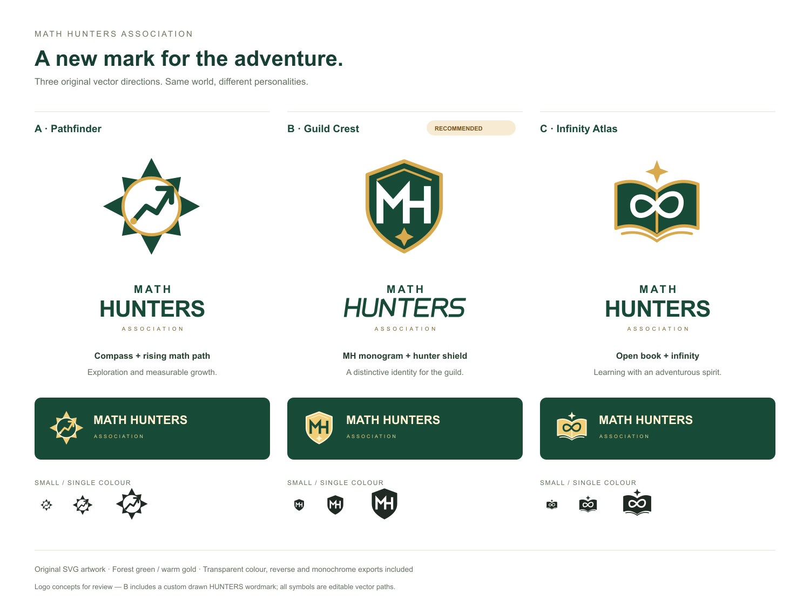
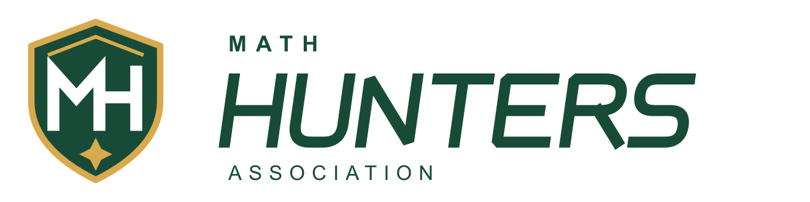

# Math Hunters — logo directions

**Selected: C — Infinity Atlas, 29 October 2026.** Applied to the shared app mark, header, footer, sign-in page, hunter license, SVG browser icon, ICO favicon, and Apple home-screen icon. Dark surfaces use the reversed version.

Canonical exports are in `public/brand/math-hunters-mark.svg` and `public/brand/math-hunters-logo.svg`, with `-reversed` and `-mono` variants.

The three original exploration directions are preserved below for reference.

## A — Pathfinder

A compass rose surrounds a rising mathematical path. Best if exploration and measured progress should lead the brand. The compact symbol has a strong directional silhouette.

## B — Guild Crest — earlier recommendation

An original MH monogram inside a gold-edged shield, with a small discovery star. The most compact and recognisable option for the navigation header, hunter license, mission cards, and app icon. The HUNTERS wordmark is drawn as editable SVG paths with angled letterforms, rather than relying on a display font.

## C — Infinity Atlas

An open book holds an infinity loop, with a discovery star above. Best if the educational identity should stay prominent while matching the fantasy world.

## Exports

Each direction includes a transparent colour, monochrome, and reversed mark, plus matching horizontal wordmarks: 18 SVGs total. Three 512px PNG symbol previews are also included. All files are in `public/brand/concepts/`.

| Concept | Colour symbol | Horizontal wordmark | Monochrome | Reversed |
|---|---|---|---|---|
| Pathfinder | [SVG](../../public/brand/concepts/pathfinder-colour.svg) | [SVG](../../public/brand/concepts/pathfinder-colour-lockup.svg) | [SVG](../../public/brand/concepts/pathfinder-mono.svg) | [SVG](../../public/brand/concepts/pathfinder-reversed.svg) |
| Guild Crest | [SVG](../../public/brand/concepts/guild-crest-colour.svg) | [SVG](../../public/brand/concepts/guild-crest-colour-lockup.svg) | [SVG](../../public/brand/concepts/guild-crest-mono.svg) | [SVG](../../public/brand/concepts/guild-crest-reversed.svg) |
| Infinity Atlas | [SVG](../../public/brand/concepts/infinity-atlas-colour.svg) | [SVG](../../public/brand/concepts/infinity-atlas-colour-lockup.svg) | [SVG](../../public/brand/concepts/infinity-atlas-mono.svg) | [SVG](../../public/brand/concepts/infinity-atlas-reversed.svg) |

Palette: forest `#174B38`, gold `#D8AA4D`, charcoal `#202923`, reversed gold `#F1CF79`, cream `#FFF3D4`. Small-size examples show the symbols at 24, 40, and 64 pixels. The source symbols and the Guild Crest HUNTERS wordmark use vector paths. Secondary type and the A/C wordmarks use editable Arial/Helvetica text; these can be outlined when a final direction is selected.

Validation: the selected canonical SVGs and all 18 concept SVGs parse successfully; each symbol and the board rasterise with the project's existing Sharp package. The board and recommended lockup were visually inspected. No package, application route, or learning behaviour changed. The selected C mark and app icons have now replaced the previous brand assets. No trademark clearance was performed.

## Application check

The applied homepage was visually checked and captured in [applied-homepage.jpg](applied-homepage.jpg). The rendered header uses the selected four-path mark, and Next.js exposes the updated ICO, SVG icon, and 180px Apple touch icon in page metadata. ICO entries were decoded and checked at 16, 32, and 48 pixels. Targeted ESLint and `git diff --check` pass. The shared component paths match the canonical selected SVG. No deployment; the full production build was not repeated for this logo-only change.
